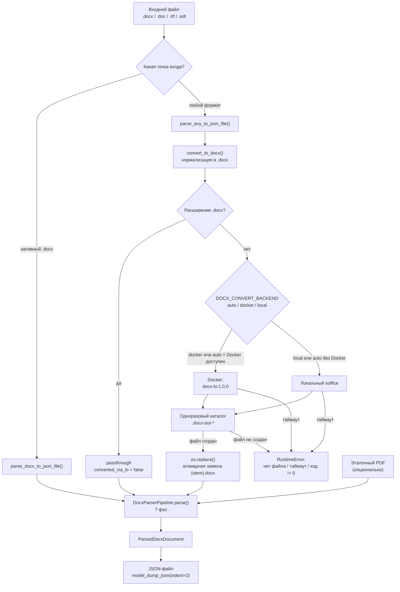
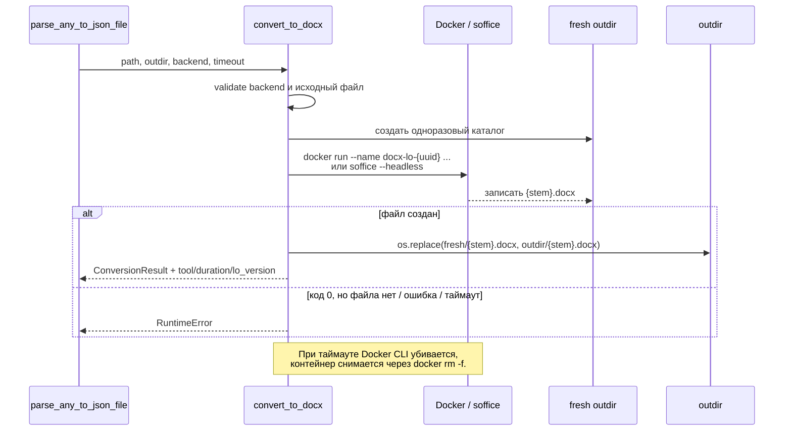
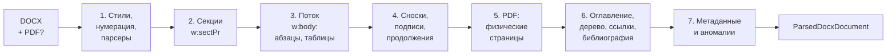

# Как работает `docx_parser`

Документ для разработчика: что происходит с файлом от загрузки до JSON, где за это
отвечает код и что можно менять, не ломая контракт.

> Актуально для `schema_version = "2.4.0"`.

---

## 1. Коротко

`docx_parser` превращает документ Word или legacy-файл в один JSON-отчет
`ParsedDocxDocument`.

Три сценария:

| Вход | Точка входа | LibreOffice |
|---|---|---|
| Уже `.docx` | `parse_docx_to_json_file()` | не нужен |
| `.doc`, `.rtf`, `.odt`, `.wps`, ... | `parse_any_to_json_file()` | нужен: файл сначала нормализуется в `.docx` |
| Нужна только конвертация | `convert_to_docx()` | нужен |

Во втором сценарии документ **сначала** конвертируется в `.docx`, и только потом
запускается общий конвейер. Отдельной ветки разбора для `.doc` нет — это важно:
все парсеры работают исключительно с OOXML-пакетом.

Эталонный PDF — опциональный, но именно он дает точные физические страницы.
PDF должен быть снят **с исходного файла**, а не с результата конвертации.

---

## 2. Общая схема



Ключевая идея: **конвертация и разбор разделены**. Конвертер отвечает только за
получение валидного `.docx` и provenance-метаданные; все содержательные выводы
делает `DocxParserPipeline`.

---

## 3. Конвертация legacy-форматов

Код: `converter.py`.

### 3.1. Выбор backend

| Значение | Поведение |
|---|---|
| `auto` (по умолчанию) | Docker, если CLI и демон отвечают; иначе локальный `soffice` |
| `docker` | Только контейнер. Нет демона — `RuntimeError`, без тихого отката на local |
| `local` | Только локальный `soffice`, Docker не проверяется |

Backend и таймаут можно задать аргументами `backend=` / `timeout=` или
переменными окружения:

| Переменная | По умолчанию | Назначение |
|---|---|---|
| `DOCX_CONVERT_BACKEND` | `auto` | backend по умолчанию |
| `DOCX_CONVERT_TIMEOUT` | `300` | таймаут конвертации, секунды |
| `DOCX_LO_IMAGE` | `docx-lo:1.0.0` | Docker-образ LibreOffice |

Для сервера рекомендуется `DOCX_CONVERT_BACKEND=docker`: иначе при недоступном
Docker можно незаметно получить другую версию LibreOffice и другой результат
экспорта.

### 3.2. Что происходит при конвертации



Почему так:

- **Одноразовый подкаталог** не позволяет принять старый `{stem}.docx` за новый
  результат. LibreOffice умеет завершиться с кодом `0`, ничего не записав.
- **`os.replace`** делает замену атомарной в пределах одной файловой системы.
  Читатель не увидит наполовину записанный файл.
- **`--name docx-lo-<uuid>`** нужен потому, что `subprocess.run(timeout=...)`
  убивает только Docker CLI. Сам контейнер продолжает работать; его надо явно
  снять через `docker rm -f`.
- **staging-каталог** монтируется в контейнер только для чтения, сеть отключена,
  память ограничена, процесс работает от UID:GID хоста.

### 3.3. Результат конвертации

`ConversionResult` содержит:

| Поле | Пример | Смысл |
|---|---|---|
| `docx_path` | `/data/out/2.docx` | путь к нормализованному файлу |
| `source_format` | `doc` | расширение исходника |
| `converted_via_lo` | `true` | была ли реальная конвертация |
| `tool` | `docker:docx-lo:1.0.0` | чем конвертировали |
| `duration_ms` | `4821` | длительность, мс |
| `lo_version` | `LibreOffice 25.2.3.2 ...` | версия LO |
| `lo_image` | `docx-lo:1.0.0` | образ, если был Docker |

Для нативного `.docx` возвращается `tool="passthrough"`, `converted_via_lo=false`,
а `duration_ms`, `lo_version`, `lo_image` остаются `None`.

Все эти поля затем попадают в `meta`, чтобы по JSON можно было отличить нативный
файл от результата LibreOffice и воспроизвести конверсию.

---

## 4. Семь фаз разбора

Код: `pipeline.py`, класс `DocxParserPipeline`.



Порядок фаз фиксирован. PDF-выравнивание стоит **до** структурного анализа:
только так страницы в оглавлении, подписях и перекрестных ссылках будут
физическими, а не эвристическими.

| # | Фаза | Основной код | Результат |
|---|---|---|---|
| 1 | Инициализация | `style_resolver.py`, `paragraph_parser.py` | каскад стилей, тема, нумерация, связанные парсеры |
| 2 | Секции | `section_header_footer_parser.py` | `sections`, границы секций в `w:body`, `HybridPageTracker` |
| 3 | Блоки | `paragraph_parser.py`, `table_parser.py`, `visual_and_math_parser.py` | `blocks`, `visuals`, `equations` |
| 4 | Сноски и таблицы | `table_parser.py`, `section_header_footer_parser.py` | связи подпись/продолжение, `footnotes` |
| 5 | PDF | `pdf_page_aligner.py` | точные страницы, координаты, `pdf_pages_audit` |
| 6 | Структура | `structure_crossref_parser.py` | `document_tree`, `cross_ref_index`, свернутое оглавление |
| 7 | Метаданные | `metadata_anomalies_parser.py` | `meta`, `settings`, `anomalies` |

### Фаза 1. Стили и общий контекст

`StyleCascadeResolver` читает `word/styles.xml`, `word/theme/theme1.xml` и
`word/numbering.xml`. Он умеет разрешать свойства по каскаду:
direct → character style → paragraph style → numbering → table style →
docDefaults → theme → engine default.

`NumberingStateTracker` ведет состояние списков. `ParagraphParser`,
`TableParser`, `VisualAndMathParser` и `SectionAndHeaderFooterParser` создаются
один раз и переиспользуются, чтобы нумерация и реестры объектов были сквозными.

### Фаза 2. Секции

`SectionAndHeaderFooterParser.discover_sections()` проходит `w:sectPr`, определяет
размеры листа, поля, ориентацию, колонтитулы и границы дочерних узлов `w:body`.
`HybridPageTracker` выбирает стратегию пагинации: нативные
`w:lastRenderedPageBreak`, если они есть, иначе геометрическую оценку.

### Фаза 3. Поток блоков

`w:body` обходится в порядке документа по секциям. Контейнеры `w:sdt` и
`mc:AlternateContent` «прозрачно» раскрываются. Абзацы получают ID `p_00001`,
таблицы — `tbl_0001`.

- `ParagraphParser` разбирает раны, поля, гиперссылки, списки, заголовки,
  микротипографику и специальные символы.
- `TableParser` рекурсивно разбирает сетку, объединения, вложенные таблицы и
  содержимое ячеек; для абзацев ячеек используется тот же `ParagraphParser`.
- `VisualAndMathParser` регистрирует картинки, фигуры, диаграммы, OLE и OMML,
  а также связывает их с родительским абзацем.

Параллельно заполняется `xml_para_to_block_map` — соответствие XML-узла и
`ParagraphBlock`; оно нужно детектору аномалий в фазе 7.

### Фаза 4. Сноски и связи таблиц

`link_table_captions_and_continuations()` связывает подпись с таблицей и
продолжения по тексту «Продолжение таблицы N». Затем
`parse_footnotes_and_endnotes()` разбирает `word/footnotes.xml` и
`word/endnotes.xml`, создавая `footnotes` и привязку к абзацу-источнику.

### Фаза 5. PDF-выравнивание

Если передан `pdf_path`, `PdfPageAligner` через PyMuPDF (`fitz`):

1. извлекает строки и изображения;
2. зонирует колонтитулы и рабочую область;
3. сопоставляет блоки DOCX со страницами PDF;
4. проставляет `page_start_est`, `page_end_est` и `pdf_*` координаты;
5. считает `sync_score` — долю совпадения текста;
6. формирует `pdf_pages_audit`.

Если текст DOCX и PDF сильно расходится, выставляется
`anomalies.pdf_docx_mismatch_warning`. Если выравнивание не применилось,
`pagination_source` остается эвристическим.

### Фаза 6. Структура и ссылки

`StructureCrossRefParser.process_document_structure()`:

- сворачивает автособранное оглавление в `TocContainerBlock`, сохраняя исходные
  абзацы;
- строит иерархию `document_tree` с семантическими ролями (введение, глава,
  приложение и т. п.);
- собирает объекты рисунков, таблиц, приложений и формул;
- разбирает библиографию и упоминания в тексте;
- проверяет номера страниц оглавления **только** при `pagination_source="pdf_exact"`.

После PDF-выравнивания страницы сносок пересчитываются по странице реально
ссылающегося на них абзаца.

### Фаза 7. Метаданные и аномалии

`MetaAndAnomaliesParser` читает `docProps/core.xml`, `docProps/app.xml` и
`word/settings.xml`, заполняет `meta`, `settings` и запускает проверки аномалий:
непринятые правки, комментарии, пустые абзацы, скрытый текст, OLE, фоновые
заливки, не черный текст, проблемы оглавления, подписей и нумерации рисунков.

Если PDF передан, `meta.word_stat_pages` перезаписывается фактическим числом
страниц, потому что значение `Pages` из `docProps/app.xml` часто устаревшее.
Поле `meta.application` не подменяется: там остается значение из `app.xml`.

---

## 5. Что получается на выходе

Корневая модель — `ParsedDocxDocument` из `schema.py`. Это единственный источник
JSON-контракта: имена полей и правила сериализации менять нужно осознанно.

```json
{
  "schema_version": "2.4.0",
  "meta": {
    "filename": "2.docx",
    "source_format": "doc",
    "converted_via_lo": true,
    "conversion_tool": "docker:docx-lo:1.0.0",
    "conversion_duration_ms": 4821,
    "lo_version": "LibreOffice 25.2.3.2 ...",
    "lo_image": "docx-lo:1.0.0",
    "pagination_source": "pdf_exact",
    "pdf_docx_sync_score": 0.998
  },
  "settings": {},
  "theme": {},
  "styles": {},
  "sections": [],
  "pdf_pages_audit": [],
  "blocks": [],
  "visuals": {},
  "footnotes": [],
  "document_tree": [],
  "cross_ref_index": {},
  "anomalies": {}
}
```

Блоки дискриминируются по `block_type`:

| `block_type` | Модель | Что внутри |
|---|---|---|
| `paragraph` | `ParagraphBlock` | текст, раны, свойства, списки, заголовки, ID рисунков и формул |
| `table` | `TableBlock` | сетка, строки, ячейки, объединения, подпись и продолжения |
| `toc_block` | `TocContainerBlock` | записи оглавления и исходные абзацы с форматированием |

Важные верхнеуровневые разделы:

- `meta` — файл, хеш, provenance конвертации, пагинация, статистика Word;
- `sections` — геометрия страниц, поля, колонтитулы, диапазоны страниц;
- `blocks` — основной линейный контент в порядке документа;
- `visuals` — реестр визуальных объектов по `visual_id`;
- `footnotes` — сноски и концевые сноски;
- `document_tree` — иерархия заголовков;
- `cross_ref_index` — рисунки, таблицы, приложения, формулы, библиография,
  упоминания и результаты разрешения ссылок;
- `anomalies` — найденные проблемы оформления.

Если PDF не передан, `model_serializer` удаляет из JSON ключи, начинающиеся с
`pdf_`, и `rendered_page_numbers_present`. Это не относится к
`meta.pagination_source` — он остается и показывает, как получены страницы.

### Источник страниц

| `meta.pagination_source` | Когда выставляется |
|---|---|
| `pdf_exact` | PDF передан и выравнивание применилось |
| `docx_native_breaks` | PDF нет, но в документе есть `w:lastRenderedPageBreak` |
| `geometric_fallback` | PDF нет и нативных разрывов нет; страницы оценены геометрически |

---

## 6. Карта модулей

```text
backend/
├── docx_parser/
│   ├── __init__.py                    публичный API
│   ├── pipeline.py                    оркестратор и две file-точки входа
│   ├── converter.py                   DOCX/legacy → DOCX через LibreOffice
│   ├── schema.py                      Pydantic-модели и JSON-контракт
│   ├── style_resolver.py              каскад стилей, тема, единицы, XML-утилиты
│   ├── paragraph_parser.py            абзацы, раны, поля, списки, типографика
│   ├── table_parser.py                таблицы, ячейки, объединения, продолжения
│   ├── visual_and_math_parser.py      картинки, фигуры, диаграммы, OLE, OMML
│   ├── section_header_footer_parser.py секции, колонтитулы, сноски, пагинация
│   ├── pdf_page_aligner.py            привязка блоков к страницам PDF
│   ├── structure_crossref_parser.py   оглавление, дерево, подписи, ссылки
│   ├── metadata_anomalies_parser.py   core/app/settings и аномалии
│   └── PIPELINE.md                    этот документ
├── docker/libreoffice/Dockerfile      запиненный образ LibreOffice
├── manual_test/                       реальные файлы и ручные CLI
└── tests/                             unit + integration
```

| Задача | Куда идти |
|---|---|
| Изменить формат JSON | `schema.py`, затем обновить тесты и этот документ |
| Добавить разбор нового элемента абзаца | `paragraph_parser.py` |
| Добавить свойство таблицы или ячейки | `table_parser.py` + `schema.py` |
| Добавить тип визуального объекта | `visual_and_math_parser.py` + `schema.py` |
| Изменить пагинацию или PDF-сверку | `pdf_page_aligner.py`, `section_header_footer_parser.py` |
| Изменить оглавление/ссылки/библиографию | `structure_crossref_parser.py` |
| Добавить аномалию | `metadata_anomalies_parser.py` + `DocumentAnomalies` |
| Изменить конвертацию или таймауты | `converter.py` |
| Изменить порядок фаз | `pipeline.py` (осторожно: есть зависимости) |

---

## 7. Как запускать

Все команды ниже выполняются из каталога `backend`: в `pytest.ini` он добавлен в
`pythonpath`, а скрипты в `manual_test/` сами добавляют его при необходимости.

```powershell
cd c:\code\raw_docx_test\backend
```

### 7.1. Тесты

```powershell
python -m compileall -q docx_parser tests
python -m pytest tests -q
```

Интеграционные тесты, которым нужен реальный LibreOffice или Docker, помечены
`integration`:

```powershell
python -m pytest tests -q -m integration
```

Если Docker/soffice недоступны, такие тесты штатно пропускаются.

### 7.2. Нативный `.docx`

```python
from pathlib import Path

from docx_parser import parse_docx_to_json_file

Path("manual_test/out").mkdir(exist_ok=True)
doc = parse_docx_to_json_file(
    "manual_test/2.docx",
    "manual_test/out/2.json",
    pdf_path="manual_test/2.pdf",  # необязательно
)
print(doc.meta.pagination_source)
```

Или готовый диагностический CLI:

```powershell
python manual_test/parse_docx.py manual_test/test.docx `
    --pdf manual_test/test.pdf --out manual_test/test_out.json
```

`parse_docx.py` принимает только `.docx`. Если `--pdf` не указан, он ищет
одноименный PDF рядом с документом.

### 7.3. Legacy-формат (`.doc`, `.rtf`, `.odt`)

```python
from pathlib import Path
from docx_parser import parse_any_to_json_file

Path("manual_test/out").mkdir(exist_ok=True)
doc = parse_any_to_json_file(
    "manual_test/2.doc",
    "manual_test/out/2.json",
    pdf_path="manual_test/2.pdf",
    outdir="manual_test/out",  # сюда будет положен промежуточный 2.docx
    backend="docker",          # auto | docker | local
    timeout=300,
)
print(doc.meta.conversion_tool, doc.meta.conversion_duration_ms)
```

То же самое с проверкой PDF-сверки:

```powershell
python manual_test/check_pdf_sync.py manual_test/3.doc manual_test/3.pdf `
    --outdir manual_test/out
```

Скрипт печатает источник пагинации, `sync_score`, покрытие страниц номерами,
расхождения оглавления и сохраняет `<stem>_pdf.json` в `outdir`.

### 7.4. Только конвертация

```python
from docx_parser import convert_to_docx

result = convert_to_docx(
    "manual_test/3.doc",
    outdir="manual_test/out",
    backend="docker",
    timeout=300,
)
print(result.docx_path)
print(result.tool, result.duration_ms, result.lo_version)
```

### 7.5. Переменные окружения

Их удобно задавать в PowerShell перед запуском:

```powershell
$env:DOCX_CONVERT_BACKEND = "docker"
$env:DOCX_CONVERT_TIMEOUT = "300"
$env:DOCX_LO_IMAGE = "docx-lo:1.0.0"
python manual_test/check_pdf_sync.py manual_test/3.doc manual_test/3.pdf
```

В bash:

```bash
export DOCX_CONVERT_BACKEND=docker
export DOCX_CONVERT_TIMEOUT=300
export DOCX_LO_IMAGE=docx-lo:1.0.0
```

### 7.6. Docker-образ

```powershell
docker build -t docx-lo:1.0.0 docker/libreoffice
docker run --rm docx-lo:1.0.0 soffice --version
```

Версия LibreOffice влияет на экспорт `.docx`, поэтому образ нужно пересобирать
осознанно и фиксировать новый тег. Версия пишется в `/etc/docx-lo-version` и в
label `lo.version`.

---

## 8. Правила и ограничения

1. **PDF снимается с исходного файла.** После `.doc → .docx` LibreOffice
   пересчитывает вёрстку; PDF, отрендеренный из результата конвертации, даст
   другую геометрию и другие номера страниц.
2. **Порядок фаз не произвольный.** Структура и перекрестные ссылки должны
   анализироваться после PDF-выравнивания: иначе номера страниц будут ложными.
3. **`schema.py` — контракт.** Переименование поля меняет JSON для потребителей.
   При несовместимом изменении поднимайте `schema_version` и обновляйте тесты.
4. **Парсеры не пишут JSON сами.** Они заполняют Pydantic-модели; сериализация
   централизована в `ParsedDocxDocument`.
5. **Legacy-форматы не разбираются напрямую.** Любой не-`.docx` сначала проходит
   через LibreOffice.
6. **Нет OCR.** Сканы и картинки с текстом не распознаются; PDF используется для
   геометрии и сверки, а не как замена содержимого DOCX.
7. **OLE-объекты не исполняются.** Внедренный Excel или MathType регистрируется,
   но не открывается; проблемные OLE попадают в
   `anomalies.embedded_ole_block_ids`.
8. **Таймаут — это ошибка, а не пустой результат.** При таймауте или отсутствии
   выходного файла выбрасывается `RuntimeError`; старый `.docx` не подставляется.
9. **Родительский каталог JSON не создается.** `outdir` создается конвертером,
   а каталог для `output_json_path` нужно подготовить заранее.
10. **`auto` может выбрать local.** Если Docker недоступен, будет использован
    локальный `soffice`; для сервера явно задавайте `DOCX_CONVERT_BACKEND=docker`.

---

## 9. Если что-то пошло не так

| Симптом | Вероятная причина | Что проверить |
|---|---|---|
| `не содержит word/document.xml` | подан не DOCX | использовать `parse_any_to_json_file` или проверить путь |
| `Docker-демон не отвечает` при `backend="docker"` | Docker не запущен | `docker info`; либо `auto`/`local` |
| `LibreOffice недоступен` | нет ни Docker, ни `soffice` | установить LO или запустить Docker |
| `Таймаут конвертации` | тяжелый legacy-файл | поднять `timeout`/`DOCX_CONVERT_TIMEOUT` |
| `файл ... не создан` | LO завершился с кодом 0, но ничего не записал | смотреть `tool`, код и хвост stderr в тексте ошибки |
| `pdf_docx_mismatch_warning` | PDF снят с другой версии документа | пересобрать PDF из исходника |
| Страницы «плывут» | нет PDF и нативных разрывов | проверить `meta.pagination_source` |
| Номера в оглавлении не сверяются | `pagination_source != "pdf_exact"` | передать корректный PDF |
| Остался контейнер `docx-lo-*` | аварийное завершение процесса | `docker ps -a --filter name=docx-lo-`, затем `docker rm -f` |
| JSON не создан | нет родительского каталога | создать каталог для `output_json_path` |

### Минимальный чек-лист изменений

- [ ] изменение отражено в `schema.py`, если меняется JSON;
- [ ] поднят `schema_version` при несовместимом изменении;
- [ ] добавлен или обновлен тест в `tests/`;
- [ ] `python -m compileall -q docx_parser tests` проходит;
- [ ] `python -m pytest tests -q` проходит;
- [ ] при изменении конвертации проверен реальный legacy-файл через Docker;
- [ ] этот документ обновлен, если поменялись фазы, поля или команды.

