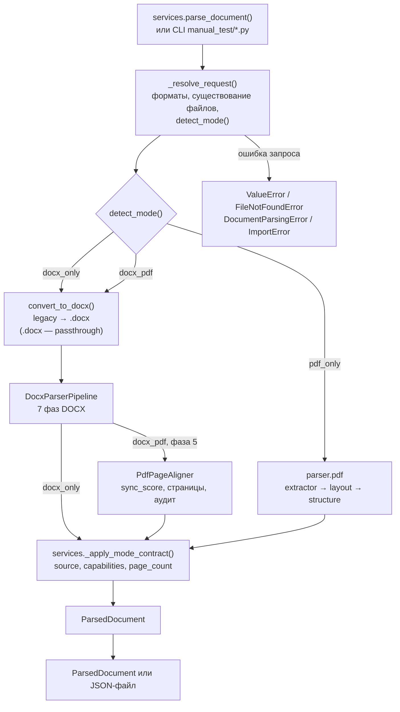
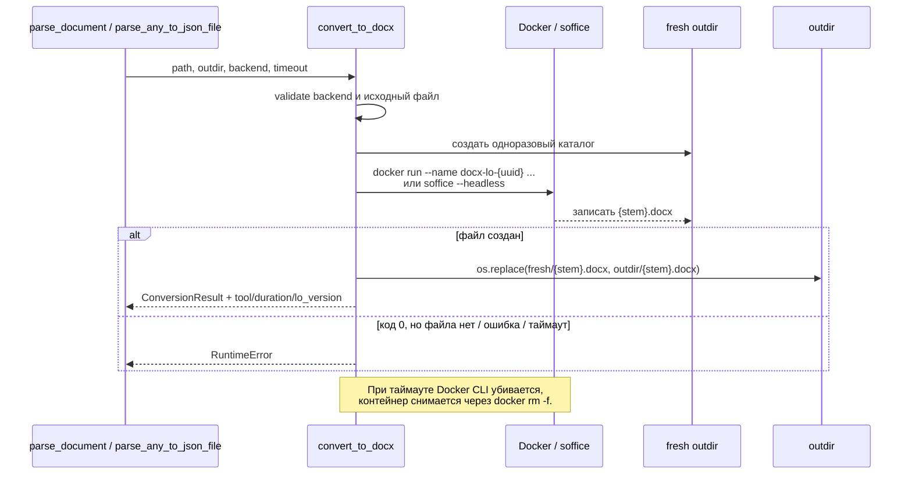
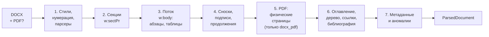

# Как работает разбор документов: `parser/core`, `parser/docx`, `parser/pdf`, `services`

Документ для разработчика: как выбрать режим, что происходит с файлами от
входа до JSON, где за это отвечает код и что можно менять, не ломая контракт.

> Актуально для `schema_version = "3.0.0"` и трёх режимов разбора: `docx_only`,
> `pdf_only`, `docx_pdf`. Контракт режимов, имена полей и матрица возможностей
> зафиксированы в [`ARCHITECTURE.md`](ARCHITECTURE.md).

---

## 1. Коротко

Разбор документов — это один сервис с тремя полноценными режимами и единой
моделью результата `ParsedDocument` (исторический алиас `ParsedDocxDocument`).
Режим определяет не набор файлов, а **источник истины**:

| Режим | Вход | Источник структуры | Источник страниц | Когда использовать |
|---|---|---|---|---|
| `docx_only` | `.docx` (или `.doc`, `.rtf`, `.odt` через LibreOffice) | DOCX: стили, нумерация, секции, сноски, ссылки | Оценка по DOCX или маркеры `w:lastRenderedPageBreak` | Нормоконтроль оформления без эталонного PDF |
| `pdf_only` | `.pdf` | Сам PDF: абзацы и заголовки восстанавливаются по геометрии | Сам PDF: число страниц точное | Проверка готового PDF без исходника: пагинация, номера страниц, границы текста |
| `docx_pdf` | `.docx` + `.pdf` | DOCX | Эталонный PDF, сверенный с DOCX | Полный нормоконтроль: форматирование из DOCX + физические страницы из PDF |

`docx_only` **никогда не читает PDF**, даже если файл передан: это позволяет
сравнивать результат с PDF-режимом и не зависеть от наличия эталона.
`pdf_only` не требует DOCX и LibreOffice. `docx_pdf` требует оба файла.

### Точки входа

| Что нужно | Точка входа | Файл |
|---|---|---|
| Python, любой режим | `parse_document()`, `parse_to_json_file()` | `services/document_parsing.py` |
| Только DOCX-конвейер | `DocxParserPipeline.parse()` / `.parse_docx_only()` | `parser/docx/pipeline.py` |
| Только PDF-конвейер | `parse_pdf()`, `PdfDocumentParser().parse()` | `parser/pdf/parser.py` |
| Конвертация legacy-формата | `convert_to_docx()` | `parser/docx/converter.py` |

Сервис — единственное место, где встречаются оба парсера. Он же последним
заполняет контрактные поля `parse_mode`, `source`, `capabilities` и `page_count`,
поэтому потребителю не нужно знать, какой парсер дал результат.

### Автоматический выбор режима

```python
from parser.core.mode import (
    DEFAULT_PARSE_MODE,    # "auto"
    PARSE_MODES,           # ("docx_only", "pdf_only", "docx_pdf")
    ParseMode,             # Literal["docx_only", "pdf_only", "docx_pdf"]
    detect_mode,           # detect_mode(docx_path, pdf_path, requested) -> ParseMode
    normalize_parse_mode,  # None/""/"auto" -> "auto"; иначе проверка значения
)
```

`parse_document(..., mode="auto")` (значение по умолчанию) выбирает режим по
фактически переданным файлам:

| `requested` | DOCX | PDF | Результат |
|---|---|---|---|
| `None` / `"auto"` | есть | есть | `docx_pdf` |
| `None` / `"auto"` | есть | нет | `docx_only` |
| `None` / `"auto"` | нет | есть | `pdf_only` |
| `None` / `"auto"` | нет | нет | `ValueError` |
| `"docx_only"` | есть | любой | `docx_only` (PDF игнорируется) |
| `"pdf_only"` | любой | есть | `pdf_only` (DOCX игнорируется) |
| `"docx_pdf"` | есть | есть | `docx_pdf` |
| явный режим | не хватает обязательного файла | — | `ValueError` |
| неизвестная строка | — | — | `ValueError` |

Регистр и пробелы нормализуются: `normalize_parse_mode(" PDF_ONLY ")` вернёт
`"pdf_only"`. Существование файлов проверяет сервис, а не `detect_mode`.

Дополнительно сервис принимает PDF в первом аргументе `document` (удобно для
разбора одного PDF): тогда DOCX отсутствует, а `pdf_path` считается тем же
файлом. Если и `document`, и `pdf_path` имеют расширение `.pdf`, но указывают
на разные файлы, это ошибка запроса. Неподдерживаемое расширение документа — тоже ошибка
запроса (`ValueError`), а не ошибка разбора.

---

## 2. Общая схема



Порядок и границы:

1. **Запрос.** Точка входа — `services.document_parsing.parse_document()` (или
   `parse_to_json_file()`); CLI в `manual_test/` передаёт пути и `mode`.
2. **Валидация и режим.** `_resolve_request()` проверяет расширения и
   существование файлов, затем `detect_mode()` фиксирует режим. Ошибки запроса
   (`ValueError`, `FileNotFoundError`) пробрасываются вызывающему коду.
3. **Ветка DOCX.** `_parse_docx_modes()` всегда пропускает документ через
   `convert_to_docx()` (для `.docx` это passthrough), после чего запускает
   `DocxParserPipeline`. В `docx_only` вызывается `parse_docx_only()`, в
   `docx_pdf` — `parse()` с PDF, и внутри конвейера выполняется фаза 5
   (PDF-выравнивание).
4. **Ветка PDF.** `_parse_pdf_only()` лениво импортирует `parser.pdf` и вызывает
   `parse_pdf()` (или `PdfDocumentParser().parse()`). DOCX и LibreOffice не
   используются.
5. **Контракт.** `_apply_mode_contract()` пересобирает `source`, `capabilities` и
   `page_count` под фактический режим. Это последняя инстанция: даже если
   парсер что-то не заполнил, потребитель увидит согласованный результат.
6. **Вывод.** Python API возвращает модель `ParsedDocument`;
   `parse_to_json_file()` пишет UTF-8 JSON с `indent=2` через
   `model_dump(mode="json")`.

Ключевая идея: **конвертация, разбор и контракт разделены**. Конвертер отвечает
только за получение валидного `.docx` и provenance-метаданные, парсеры — за
содержательные выводы, сервис — за режим и единую форму результата.

---

## 3. Конвертация legacy-форматов

Код: `parser/docx/converter.py`.

### 3.1. Выбор backend

| Значение | Поведение |
|---|---|
| `auto` (по умолчанию) | Docker, если CLI и демон отвечают; иначе локальный `soffice` |
| `docker` | Только контейнер. Нет демона — `RuntimeError`, без тихого отката на local |
| `local` | Только локальный `soffice`, Docker не проверяется |

Backend и таймаут можно задать аргументами `backend=` / `timeout=` (в сервисе и
CLI) или переменными окружения:

| Переменная | По умолчанию | Назначение |
|---|---|---|
| `DOCX_CONVERT_BACKEND` | `auto` | backend по умолчанию |
| `DOCX_CONVERT_TIMEOUT` | `300` | таймаут конвертации, секунды |
| `DOCX_LO_IMAGE` | `docx-lo:1.0.0` | Docker-образ LibreOffice |

Для развёрнутого сервиса рекомендуется `DOCX_CONVERT_BACKEND=docker`: иначе при недоступном
Docker можно незаметно получить другую версию LibreOffice и другой результат
экспорта.

### 3.2. Что происходит при конвертации



Почему так:

- **Одноразовый подкаталог** не позволяет принять старый `{stem}.docx` за новый
  результат. LibreOffice умеет завершиться с кодом `0`, ничего не записав.
- **`os.replace`** делает замену атомарной в пределах одной файловой системы.
  Читатель не увидит наполовину записанный файл.
- **`--name docx-lo-<uuid>`** нужен потому, что `subprocess.run(timeout=...)`
  убивает только Docker CLI. Сам контейнер продолжает работать; его надо явно
  снять через `docker rm -f`.
- **staging-каталог** монтируется в контейнер только для чтения, сеть отключена,
  память ограничена, процесс работает от UID:GID хоста.

### 3.3. Результат конвертации

`ConversionResult` содержит:

| Поле | Пример | Смысл |
|---|---|---|
| `docx_path` | `/data/out/2.docx` | путь к нормализованному файлу |
| `source_format` | `doc` | расширение исходника |
| `converted_via_lo` | `true` | была ли реальная конвертация |
| `tool` | `docker:docx-lo:1.0.0` | чем конвертировали |
| `duration_ms` | `4821` | длительность, мс |
| `lo_version` | `LibreOffice 25.2.3.2 ...` | версия LO |
| `lo_image` | `docx-lo:1.0.0` | образ, если был Docker |

Для нативного `.docx` возвращается `docx_path` исходного файла,
`tool="passthrough"`, `converted_via_lo=false`, а `duration_ms`, `lo_version`,
`lo_image` остаются `None`.

Все эти поля затем попадают в `meta`, чтобы по JSON можно было отличить нативный
файл от результата LibreOffice и воспроизвести конверсию.

Важно про пару «имя/хэш». Сервис (`services.document_parsing.py`) заполняет
`source.docx_filename` и `source.docx_sha256` от **исходного загруженного файла**
(`document_path`): для `.doc`/`.rtf`/`.odt` это хэш исходника до конвертации, а
не результата LibreOffice. `meta.filename`/`meta.file_sha256` при этом всегда
описывают уже разобранный `.docx`; для нативного файла значения совпадают.
Прямой вызов `DocxParserPipeline`/`parse_any_to_json_file` (без сервиса)
заполняет `source` из `meta`, то есть описывает сконвертированный DOCX —
это осознанное различие точек входа, а не рассинхронизация внутри одной пары.

---

## 4. Семь фаз разбора DOCX

Код: `parser/docx/pipeline.py`, класс `DocxParserPipeline`. Обе точки входа —
`parse()` (режим по фактическим файлам: с PDF это `docx_pdf`, без PDF —
`docx_only`) и `parse_docx_only()` (PDF из конструктора игнорируется) — вызывают
общий `_parse_core()`, поэтому фазы не дублируются. Режим `pdf_only` в
DOCX-конвейере даёт понятный `ValueError`.



Порядок фаз фиксирован. PDF-выравнивание стоит **до** структурного анализа:
только так страницы в оглавлении, подписях и перекрестных ссылках будут
физическими, а не эвристическими. В `docx_only` фаза 5 пропускается целиком.

| # | Фаза | Основной код | Результат |
|---|---|---|---|
| 1 | Инициализация | `parser/docx/style_resolver.py`, `parser/docx/paragraph_parser.py` | каскад стилей, тема, нумерация, связанные парсеры |
| 2 | Секции | `parser/docx/section_header_footer_parser.py` | `sections`, границы секций в `w:body`, `HybridPageTracker` |
| 3 | Блоки | `parser/docx/paragraph_parser.py`, `parser/docx/table_parser.py`, `parser/docx/visual_and_math_parser.py` | `blocks`, `visuals`, `equations` |
| 4 | Сноски и таблицы | `parser/docx/table_parser.py`, `parser/docx/section_header_footer_parser.py` | связи подпись/продолжение, `footnotes` |
| 5 | PDF | `parser/docx/pdf_page_aligner.py` | точные страницы, координаты, `pdf_pages_audit` |
| 6 | Структура | `parser/docx/structure_crossref_parser.py` | `document_tree`, `cross_ref_index`, свернутое оглавление |
| 7 | Метаданные | `parser/docx/metadata_anomalies_parser.py` | `meta`, `settings`, `anomalies` |

### Фаза 1. Стили и общий контекст

`StyleCascadeResolver` читает `word/styles.xml`, `word/theme/theme1.xml` и
`word/numbering.xml`. Он умеет разрешать свойства по каскаду:
direct → character style → paragraph style → numbering → table style →
docDefaults → theme → engine default.

`NumberingStateTracker` ведет состояние списков. `ParagraphParser`,
`TableParser`, `VisualAndMathParser` и `SectionAndHeaderFooterParser` создаются
один раз и переиспользуются, чтобы нумерация и реестры объектов были сквозными.

### Фаза 2. Секции

`SectionAndHeaderFooterParser.discover_sections()` проходит `w:sectPr`, определяет
размеры листа, поля, ориентацию, колонтитулы и границы дочерних узлов `w:body`.
`HybridPageTracker` выбирает стратегию пагинации: нативные
`w:lastRenderedPageBreak`, если они есть, иначе геометрическую оценку.

### Фаза 3. Поток блоков

`w:body` обходится в порядке документа по секциям. Контейнеры `w:sdt` и
`mc:AlternateContent` «прозрачно» раскрываются. Абзацы получают ID `p_00001`,
таблицы — `tbl_0001`.

- `ParagraphParser` разбирает раны, поля, гиперссылки, списки, заголовки,
  микротипографику и специальные символы.
- `TableParser` рекурсивно разбирает сетку, объединения, вложенные таблицы и
  содержимое ячеек; для абзацев ячеек используется тот же `ParagraphParser`.
- `VisualAndMathParser` регистрирует картинки, фигуры, диаграммы, OLE и OMML,
  а также связывает их с родительским абзацем.

Параллельно заполняется `xml_para_to_block_map` — соответствие XML-узла и
`ParagraphBlock`; оно нужно детектору аномалий в фазе 7.

### Фаза 4. Сноски и связи таблиц

`link_table_captions_and_continuations()` связывает подпись с таблицей и
продолжения по тексту «Продолжение таблицы N». Затем
`parse_footnotes_and_endnotes()` разбирает `word/footnotes.xml` и
`word/endnotes.xml`, создавая `footnotes` и привязку к абзацу-источнику.

### Фаза 5. PDF-выравнивание (только `docx_pdf`)

Если режим `docx_pdf`, `PdfPageAligner` через PyMuPDF (`pymupdf`):

1. извлекает строки и изображения общим кодом
   `parser.docx.pdf_page_text.read_page_lines()` / `read_page_image_boxes()` —
   тем же, что использует `parser.pdf`;
2. зонирует колонтитулы и рабочую область;
3. сопоставляет блоки DOCX со страницами PDF монотонно по потоку строк;
4. проставляет `page_start_est`, `page_end_est` и `pdf_*` координаты;
5. считает `sync_score` — долю совпадения текста;
6. формирует `pdf_pages_audit`.

Если текст DOCX и PDF сильно расходится (`sync_score < 0.80`), выставляется
`anomalies.pdf_docx_mismatch_warning`, координатная привязка не применяется
(`alignment_applied=False`), а `pagination_source` остаётся эвристическим.
Подробнее — раздел 6.

### Фаза 6. Структура и ссылки

`StructureCrossRefParser.process_document_structure()`:

- сворачивает автособранное оглавление в `TocContainerBlock`, сохраняя исходные
  абзацы;
- строит иерархию `document_tree` с семантическими ролями (введение, глава,
  приложение и т. п.);
- собирает объекты рисунков, таблиц, приложений и формул;
- разбирает библиографию и упоминания в тексте;
- проверяет номера страниц оглавления **только** при `pagination_source="pdf_exact"`.

После PDF-выравнивания страницы сносок пересчитываются по странице реально
ссылающегося на них абзаца.

### Фаза 7. Метаданные и аномалии

`MetaAndAnomaliesParser` читает `docProps/core.xml`, `docProps/app.xml` и
`word/settings.xml`, заполняет `meta`, `settings` и запускает проверки аномалий:
непринятые правки, комментарии, пустые абзацы, скрытый текст, OLE, фоновые
заливки, не черный текст, проблемы оглавления, подписей и нумерации рисунков.

В `docx_pdf` с успешным выравниванием `meta.word_stat_pages` перезаписывается
фактическим числом страниц PDF, потому что значение `Pages` из `docProps/app.xml`
часто устаревшее. В `docx_only` PDF нет: `meta.word_stat_pages` сохраняет
значение из `app.xml` и **не** подменяет `page_count`; `meta.pdf_*` остаются
`None`, `rendered_page_numbers_present` не заполняется. Поле `meta.application`
не подменяется никогда: там остается значение из `app.xml`.

---

## 5. Автономный PDF-парсер (`pdf_only`)

Код: пакет `parser/pdf/`. Он не требует DOCX, LibreOffice и OCR. Публичный API:

```python
from parser.pdf import PdfDocumentParser, parse_pdf

document = parse_pdf("manual_test/test.pdf")
# или
document = PdfDocumentParser("manual_test/test.pdf").parse()
```

Парсер собирает результат из трёх слоёв, каждый из которых можно тестировать
отдельно:

| Слой | Файл | Что делает |
|---|---|---|
| Факты листа | `parser/pdf/extractor.py` | страницы и размеры, строки/спаны с bbox, шрифт, кегль, bold/italic, цвет, изображения, таблицы |
| Вёрстка | `parser/pdf/layout.py` | поля, текстовая область, зоны колонтитулов, номера страниц, межстрочный интервал, аудит листов, секции по размеру страницы |
| Структура | `parser/pdf/structure.py` | абзацы в порядке чтения, заголовки, списки, таблицы, изображения, оглавление, дерево документа |

Общий с DOCX-выравниванием код извлечения живёт в
`parser/docx/pdf_page_text.py` (`read_page_lines`, `read_page_image_infos`,
`read_page_image_boxes`), общие примитивы — в
`parser/docx/pdf_text_utils.py` (`normalize_compact`, `parse_page_number`,
`PT_TO_MM`, `pt_to_mm`). Благодаря этому оба парсера сравнивают текст и
распознают номера страниц одинаково.

### 5.1. Что извлекается из PDF

- **Страницы и геометрия.** Размер листа в миллиметрах, ориентация, поворот.
- **Строки и спаны.** Текст, bbox, гарнитура, кегль, признаки bold/italic, цвет.
  Фрагменты одной визуальной строки склеиваются по базовой линии (допуск 1.2 мм):
  это необходимо для записей оглавления с табуляцией, которые PyMuPDF разбивает
  на несколько объектов.
- **Изображения.** `get_images(full=True)` + `get_image_info`: bbox, xref,
  размеры в пикселях и формат; фрагменты одного изображения кластеризуются с
  допуском 2 мм.
- **Таблицы.** `page.find_tables(strategy="lines_strict")` запускается только
  на страницах с векторной графикой (не менее 4 объектов), затем отбрасываются
  вырожденные результаты (меньше 2 строк или меньше 2 столбцов). Текст ячеек
  нормализуется, строки помечаются признаком `in_table`.

### 5.2. Эвристики вёрстки

- **Поля.** Оцениваются по процентилям текстового bbox на группу страниц одного
  размера: верхнее и левое — по нижним процентилям (чтобы абзацный отступ и
  заголовки не завышали оценку), нижнее и правое — по верхним. Значения
  ограничены диапазоном 3…80 мм и считаются оценкой, а не `w:sectPr`.
- **Текстовая область и колонтитулы.** `text_area_width_mm` вычисляется из
  ширины листа и полей; строки выше верхнего поля и ниже нижнего относятся к
  колонтитулам, остальные — к телу документа.
- **Номера страниц.** Кандидат — короткая строка с номером (`"2"`, `"- 2 -"`,
  `"Стр. 2"`), кегль не меньше 7.5 pt (маркеры сносок мельче). Ориентация
  выбирается по всему документу: доминирующий колонтитул (верхний или нижний)
  важнее отдельного листа. Выравнивание номера (`left`/`center`/`right`)
  определяется относительно центра листа с допуском 18 мм. Сдвиг нумерации
  (например, титульный лист без номера) — мода разностей «напечатанный номер −
  физический лист».
- **Секции.** Страницы группируются по одинаковому размеру листа; для группы
  синтезируется `SectionProperties` с оцененными полями, `text_area_width_mm` и
  **точными** `page_start_est`/`page_end_est`.
- **Аудит.** На каждый лист строится `PdfPageAudit`: наличие и положение номера,
  совпадение с физическим листом, шрифт номера, границы тела, свободное место
  внизу.
- **Межстрочный интервал.** Шаг — разность верхних краев соседних строк тела
  одного доминирующего кегля (при равном кегле он равен шагу базовых линий),
  интервал — шаг в pt, делённый на кегль. Строки таблиц и напечатанные номера
  (`^\d{1,4}$`) не участвуют, пары вне окна 0.8–2.5 отбрасываются как отбивки.
  Сводное значение — медиана по пулу пар всего документа. Это типографское
  отношение шага к кеглю, а не множитель Word: одиночная строка Word для
  Times New Roman занимает ≈1.15 кегля (зависит от гарнитуры), поэтому
  полуторному интервалу Word соответствует ≈1.72; в множитель Word его переводит
  `rule_engine` (`PDF_SINGLE_LINE_FACTOR = 1.15`). Не путать с оценкой структуры
  PDF: `structure.py` считает `line_spacing_value` как шаг/(кегль×1.2) с
  отсечением 0.8–3.0 — это грубая оценка множителя одного абзаца, а не
  «шкала Word» и не `leading_ratio` из `layout.py`.

### 5.3. Восстановление структуры

- **Абзацы.** Строки тела группируются по вертикальным разрывам: новый абзац
  начинается при разрыве больше `max(1.6 × медианного, медианный + 1.6 мм)`,
  при абзацном отступе первой строки от 2.5 мм, при смене кегля/начертания или
  при начале строки-заголовка. Абзац, разорванный между листами, получает точные
  `page_start_est`/`page_end_est`; мягкий перенос
  (`pdf_has_hyphenated_break`) склеивается. Абзацный отступ первой строки
  измеряется как сдвиг первой строки относительно второй (отрицательный —
  висячий); если строка одна, абзац — заголовок/список или выключен по центру,
  `indent_first_line_mm=None`, а не `0` (`indent_first_line_source="pdf_unmeasured"`).
- **Раны.** `text_raw == concat(runs)`; свойства рана (`font`, `size`, `bold`,
  `italic`, `color`) помечены `PropertySource="pdf_estimate"`.
- **Заголовки.** Эвристика по кеглю относительно базового (1.15 — заголовок,
  1.3 — верхний уровень), полужирному начертанию, нумерации `1`, `1.2`, `1.2.3`,
  префиксам «Глава N»/«Раздел N» и структурным словам (введение, заключение,
  список источников, термины и определения, приложение, продолжение приложения
  и т. п.). Уровень нумерованного заголовка равен глубине номера (`3.1.1` — 3),
  у заголовка без номера — по кеглю; уверенность помечается
  `heuristic_visual` или `structural_keyword_match`. Метки служебных страниц
  («ВЫПУСКНАЯ КВАЛИФИКАЦИОННАЯ РАБОТА», «РАБОТА ВЫПОЛНЕНА», «ЗАДАНИЕ»)
  заголовками не считаются (`parser/core/heading_labels.py`), а строка,
  начинающаяся со строчной буквы, — обычный текст, даже если первое слово
  совпало с названием раздела («определения потенциальных путей…»).
- **Списки.** Маркер (`•`, `-`, `1.`, `а)`, `IV.`) распознаётся в начале абзаца;
  заполняется `ListItemMetadata` (`mechanism="manual_text_prefix"`, уровень по
  отступу, формат нумерации, регистр первой буквы, конечная пунктуация).
- **Таблицы.** `TableBlock`/`TableRow`/`TableCell` с координатами, ширинами
  столбцов и классификацией ячеек (`empty`, `dash_placeholder`, `numeric`,
  `text`, `mixed`).
- **Изображения.** `VisualObject(visual_kind="raster_image", placement="inline")`
  с привязкой к странице и координатами.
- **Оглавление.** Страница считается страницей оглавления, если на ней не меньше
  трёх строк с отточием (`.`). Область расширяется на перенесённые записи;
  записи разбираются на номер, заголовок и страницу и сверяются с найденными
  заголовками (совпадение текста и номера страницы).
- **Дерево.** `document_tree` строится по заголовкам с уровнями и семантическими
  ролями.

### 5.4. Обогащение перекрёстных ссылок

После сборки `ParsedDocument` PDF-парсер вызывает формат-независимый слой
`parser/enrichment/` и заполняет `cross_ref_index`:

- `extract_bibliography` — записи раздела с `semantic_role="bibliography"`:
  нумерованные абзацы (`1.`, `2)`, `[3]`) задают `order_index`, абзацы без
  номера приклеиваются к предыдущей записи;
- `extract_captions` — подписи «Рисунок N», «Таблица N», «Приложение N/А»;
  подпись рисунка связывается с ближайшим изображением той же страницы
  (`target_object_id`);
- `extract_mentions` — упоминания в тексте тела: `[1]`, «рис. 2», «табл. 3»,
  «приложение Б», «(Иванов, 2020)»; падежные формы («таблицах», «рисунками»)
  и перечисления («5,6») разбираются в одно упоминание с несколькими целями,
  а диапазоны «1–4» и «2.1–2.3» раскрываются в отдельные цели по тем же
  правилам, что и в DOCX-конвейере; цели разрешаются по `order_index`
  библиографии и `number_str` подписей.

Результат: `capabilities.cross_references=True`, `cross_ref_index` содержит
`bibliography`, `figures`/`tables`/`Apps` и `mentions`; у записей выставляется
`is_cited_in_text`, у подписей — `is_mentioned_in_text`/`first_mention_block_id`
и `all_mention_ids`. `capabilities.visual_registry` поднимается до `True`, если
хотя бы одна подпись рисунка связалась с изображением PDF. Слой не меняет
`blocks`, `document_tree` и координаты — только дополняет индекс.

Абзацы-подписи исключаются из поиска упоминаний: подпись сама называет объект,
но не является ссылкой в тексте, иначе рисунок считался бы упомянутым из-за
собственной подписи. Подписи без явного разделителя, продолжение которых
похоже на предложение («Таблица 1 показывает динамику…»), отбрасываются, а
повторные номера одного типа дедуплицируются — предпочтение отдаётся варианту
с разделителем.

Известные расхождения с DOCX-конвейером на реальной паре `manual_test/3.*`
(сверка после унификации: mentions 7 в PDF против 9 в DOCX, таблицы 6/6,
рисунки 4 в PDF против 2 в DOCX):

- **Рисунки.** PDF-слой находит 4 подписи против 2 в DOCX: DOCX-конвейер не
  распознаёт подписи «Рис. 3»/«Рис. 4», это ограничение DOCX-парсера вне
  области унификации. У общих номеров 1 и 2 флаги `is_mentioned_in_text`
  совпадают; `fig_004` упомянут в PDF ссылкой «Рис. 4» из тела.
- **Таблица 6.** В PDF признак `is_mentioned_in_text=True` ставит абзац
  «Данные отражены в таблицах 5,6.» (`p_00384`): перечисление разбирается в
  одну ссылку с целями 5 и 6. В DOCX тот же флаг дополнительно подтверждает
  текст ячейки «Продолжение таблицы 6» (`tbl_0006_r5_c0_p0`), а общий слой
  сканирует только абзацы тела — текст ячеек ему недоступен. Флаги таблиц
  1–6 в итоге совпадают, включая `tbl_005`, который до исправления регекса
  падежных форм не распознавался.

### 5.5. Что точное, а что оценочное

| Данные | Статус в `pdf_only` |
|---|---|
| Число страниц, физические номера листов | **Точно**: `page_count.method="pdf_exact"`, `confidence="high"` |
| Страницы блоков (`page_start_est`/`page_end_est`) | **Точно** по физической пагинации PDF |
| Координаты вёрстки (`pdf_*_mm`), границы тела, зоны колонтитулов | Измерены по PDF, но это оценка вёрстки; `capabilities.pdf_layout_coordinates=True` |
| Заголовки, списки, абзацы, оглавление, дерево | Эвристика; свойства помечены `pdf_estimate`; отступ первой строки — `None`, когда геометрия не позволяет измерить |
| Поля страниц и `text_area_width_mm` | Оценка по процентилям |
| Межстрочный интервал (`leading_ratio`, `line_pitch_mm`) | Оценка по шагу соседних строк тела одного кегля |
| Стили, нумерация DOCX, сноски | **Недоступны**: флаги `capabilities` равны `False` |
| Библиография, подписи, упоминания, `cross_ref_index` | Эвристика общего слоя `parser.enrichment`; `cross_references=True`, но цели ссылок могут остаться неразрешёнными |
| `sections` | Синтезированы по группам страниц одного размера (не `w:sectPr`), `sections_parsed=False` |
| `visuals` | Только растровые изображения PDF; `visual_registry=True`, только если подпись рисунка связалась с изображением |

### 5.6. Ограничения PDF-режима

- **Нет OCR.** Скан или PDF без текстового слоя даёт пустой `blocks`; число
  страниц при этом остаётся точным. Распознавание изображений не выполняется.
- **Структура оценочная.** Нет `styles.xml`, `numbering.xml` и `w:sectPr`:
  возможны склейка/разрыв абзацев, неверные границы таблиц и колонок, ложные
  заголовки.
- **Таблицы ищутся по линиям.** Таблица без векторных границ (только отступы)
  не будет найдена.
- **Оглавление — только с отточием.** Оглавление без точек или с иным
  заполнителем останется обычными абзацами.
- **Многоколоночная вёрстка** может давать ложные абзацы: координаты
  (`pdf_*_mm`) позволяют проверить результат самостоятельно.
- **Нет сносок DOCX.** `footnotes=[]`. Перекрёстные ссылки восстанавливаются
  эвристически (`cross_ref_index`), поэтому могут быть неполными: ссылка без
  списка литературы или подписи останется без цели.
- **Шифрованные и повреждённые PDF** не поддерживаются: ошибка пробрасывается
  сервису, JSON не собирается.

### 5.7. Метаданные `pdf_only`

`meta` собирает `parser/pdf/parser.py`. Поля `docProps` DOCX в этом режиме
недоступны, поэтому часть метаданных остаётся `None`; сериализатор всё равно
сохраняет `pdf_*`-ключи, потому что `source.has_pdf=True`.

| Поле `meta` | Значение | Происхождение |
|---|---|---|
| `filename`, `file_sha256` | имя и SHA-256 PDF | сам файл |
| `source_format` | `"pdf"` | формат источника |
| `converted_via_lo`, `conversion_tool`, `conversion_duration_ms`, `lo_version`, `lo_image` | `False` / `None` | конвертации не было |
| `pdf_filename`, `pdf_sha256` | имя и SHA-256 PDF | дублируют источник |
| `rendered_page_numbers_present` | `True`/`False` | аудит колонтитулов `layout.py` |
| `pagination_source` | `"pdf_exact"` | страницы измерены по PDF |
| `pdf_docx_sync_score` | `None` | DOCX в режиме нет |
| `pdf_dominant_font_size_pt` | доминирующий кегль тела, pt | `layout.py`: размер, которым набрано больше символов (без таблиц и номеров) |
| `pdf_median_leading_ratio` | медианный интервал (шаг строк / кегль) | `layout.py`: пары соседних строк одного кегля, окно 0.8–2.5 |
| `pdf_median_line_pitch_mm` | медианный шаг верхних краев строк, мм | `layout.py`: те же пары |
| `pdf_leading_sample_count` | число измеренных пар строк | `layout.py` |
| `word_stat_pages` | число страниц PDF | физические листы, совпадает с `page_count.total_pages` |
| `word_stat_words`, `word_stat_chars_with_spaces`, `word_stat_chars_no_spaces` | статистика по тексту PDF | текстовый слой |
| `author`, `last_modified_by`, `created_iso`, `modified_iso`, `template_name`, `application` | `None` | `docProps` DOCX недоступны |

Фактический пример для `manual_test/2.pdf`: `total_pages=69`, `method="pdf_exact"`,
`confidence="high"`, `sections=1` (страницы 1–69), `blocks=407`,
`pdf_pages_audit=69`, `source_format="pdf"`, `word_stat_pages=69`.

---

## 6. Комбинированный режим `docx_pdf` и `sync_score`

`docx_pdf` — единственный режим, где оба источника используются одновременно:
DOCX даёт структуру и форматирование, PDF — физические страницы и координаты
вёрстки. Технически это тот же DOCX-конвейер; PDF подключается только в фазе 5.

### 6.1. Сверка текстов

`PdfPageAligner` считает `sync_score` — долю текста DOCX, найденную в PDF:

1. из абзацев DOCX берутся нормализованные фрагменты длиной от 10 символов
   (первые 25 символов); для таблиц — первые 5 строк;
2. из PDF собирается непрерывный поток нормализованного текста тела (без
   колонтитулов и номеров страниц);
3. `sync_score` = доля фрагментов DOCX, найденных в потоке PDF.

Порог — **0.80**:

| `sync_score` | Что происходит | `meta.pagination_source` | `capabilities.exact_pagination` |
|---|---|---|---|
| `>= 0.80` | Монотонное выравнивание блоков и таблиц по страницам PDF; проставляются `pdf_*` координаты; номера оглавления сверяются | `pdf_exact` | `True` |
| `< 0.80` | `alignment_applied=False`; блоки остаются на эвристических страницах DOCX; в `anomalies.pdf_docx_mismatch_warning` пишется предупреждение | `docx_native_breaks` или `geometric_fallback` | `False` |

`pdf_pages_audit` заполняется в обоих случаях: он описывает реальные листы PDF.

### 6.2. Число страниц при расхождении

Если PDF прочитан, число его страниц **точное при любом `sync_score`**: даже при
расхождении текста блоки не привязываются, но количество листов измерено.
Поэтому сервис не понижает `page_count.method`/`confidence`, а объясняет
расхождение в `page_count.note`:

> «Число страниц измерено по эталонному PDF (N) и точное, но блоки не привязаны
> к страницам из-за расхождения текста DOCX и PDF (sync_score …)».

`capabilities.exact_pagination` при этом остаётся `False` — флаг означает именно
точную привязку содержимого к страницам, а не факт измерения количества листов.
Сервис также выставляет `capabilities.pdf_layout_coordinates=False`: PDF прочитан,
но координат вёрстки и постраничных номеров у блоков нет (прямой вызов
`DocxParserPipeline` без сервиса оставляет `True`, так как PDF прочитан).

Это два разных пространства страниц, и расхождение зафиксировано контрактом:

- `page_count.total_pages` — фактическое число листов PDF; оно же остаётся в
  `meta.word_stat_pages` и `pdf_pages_audit`;
- `sections[-1].page_end_est` синхронизируется с числом листов PDF;
- `block.page_start_est`/`page_end_est` — оценка DOCX, она **может превышать**
  `page_count.total_pages`; `pdf_*`-координат у блоков в этой ветке нет
  (регресс-тест: DOCX с оценкой больше PDF).

Потребитель, которому важно только число страниц, может доверять
`page_count.total_pages`; потребитель, которому важны страницы блоков, должен
проверить `capabilities.pdf_layout_coordinates`/`exact_pagination` и/или
`sync_score`, а не сравнивать номера блоков с `total_pages`.

### 6.3. Правила режима

- PDF должен быть снят **с исходного файла**, а не с результата конвертации
  LibreOffice: после `.doc → .docx` вёрстка пересчитывается.
- При низком `sync_score` PDF не выбрасывается: аудит и число страниц остаются,
  но структура DOCX не искажается «подгонкой» под чужой PDF.
- `docx_only` PDF не читает, поэтому сравнение `docx_only` и `docx_pdf` на одном
  DOCX — корректный способ проверить, что даёт эталонная пагинация.

---

## 7. Оценка страниц без PDF

В `docx_only` физического PDF нет, поэтому `page_count` всегда оценочный (кроме
случая с нативными маркерами разрыва). Значение собирается в
`pipeline._estimate_docx_only_page_count()` как максимум из:

- `page_end_est` по всем секциям;
- `page_end_est` по всем блокам, включая вложенные блоки ячеек таблиц и
  `TocContainerBlock`;
- `1` — по контракту `PageCountInfo.total_pages >= 1`.

Последняя секция синхронизируется: `sections[-1].page_end_est >= total_pages`.

| Источник | `method` | `confidence` | Когда выставляется |
|---|---|---|---|
| `w:lastRenderedPageBreak` в DOCX | `docx_native_breaks` | `medium` | Word сохранил маркеры разрывов; страницы измерены, а не оценены |
| Геометрия DOCX (высоты абзацев, таблиц, разрывы) | `geometric_estimation` | `low` | Маркеров нет; возможна погрешность |
| `Pages` из `docProps/app.xml` | `app_xml_metadata` | `low` | Только при валидации старого JSON 2.x, когда новых полей нет; `docx_only` это значение не использует |
| PDF | `pdf_exact` | `high` | `pdf_only` и `docx_pdf` |

`capabilities.page_count_estimated = method not in ("pdf_exact",
"docx_native_breaks")`: маркеры `lastRenderedPageBreak` дают измеренное число
страниц, а не оценку. `note` в `PageCountInfo` всегда объясняет происхождение
числа.

Важно: в `docx_only` значение `meta.word_stat_pages` из `app.xml` остаётся в
метаданных как исторический факт, но **не** подменяет `page_count` — иначе
устаревшее `Pages` (например, 21 при фактических 231) выглядело бы точным.

---

## 8. Что получается на выходе

Корневая модель — `ParsedDocument` из `parser/core/schema.py`. Это единственный источник
JSON-контракта: имена полей и правила сериализации менять нужно осознанно.
`ParsedDocxDocument = ParsedDocument` — алиас для `rule_engine` и старых
импортов.

```json
{
  "schema_version": "3.0.0",
  "parse_mode": "docx_pdf",
  "source": {
    "mode": "docx_pdf",
    "has_docx": true,
    "has_pdf": true,
    "docx_filename": "2.docx",
    "docx_sha256": "<sha256 документа>",
    "pdf_filename": "2.pdf",
    "pdf_sha256": "<sha256 pdf>"
  },
  "capabilities": {
    "styles_parsed": true,
    "numbering_parsed": true,
    "sections_parsed": true,
    "exact_pagination": true,
    "pdf_layout_coordinates": true,
    "visual_registry": true,
    "footnotes_parsed": true,
    "cross_references": true,
    "word_metadata": true,
    "page_count_estimated": false
  },
  "page_count": {
    "total_pages": 69,
    "method": "pdf_exact",
    "confidence": "high",
    "note": null
  },
  "meta": {
    "filename": "2.docx",
    "file_sha256": "<sha256 документа>",
    "source_format": "docx",
    "converted_via_lo": false,
    "pagination_source": "pdf_exact",
    "pdf_filename": "2.pdf",
    "pdf_sha256": "<sha256 pdf>",
    "pdf_docx_sync_score": 1.0
  },
  "settings": {},
  "theme": {},
  "styles": {},
  "sections": [],
  "pdf_pages_audit": [],
  "blocks": [],
  "visuals": {},
  "footnotes": [],
  "document_tree": [],
  "cross_ref_index": {},
  "anomalies": {}
}
```

Числа в примере — фактический результат разбора `manual_test/2.docx` +
`manual_test/2.pdf`: 69 страниц, `sync_score=1.0`, `exact_pagination=true`,
`pdf_layout_coordinates=true`.

### Контрактные поля режима

| Поле | Смысл |
|---|---|
| `parse_mode` | Фактический режим: `docx_only`, `pdf_only` или `docx_pdf` |
| `source` | Какие файлы реально участвовали, их имена и SHA-256 |
| `capabilities` | Какие данные извлечены; потребитель обязан проверять флаг перед использованием поля |
| `page_count` | Число страниц, способ получения и достоверность |

`source.has_pdf` — ключевой признак для сериализации: при `False` из JSON
удаляются все ключи `pdf_*` и `rendered_page_numbers_present` (рекурсивно, на
всех уровнях). Исключение — `capabilities.pdf_layout_coordinates`: это
контрактный флаг матрицы возможностей, он остаётся всегда (в режиме без PDF
равен `False`). При `has_pdf=True` поля `pdf_*` остаются, даже если
`meta.pdf_filename` пуст (у PDF-парсера PDF — единственный источник).

### Матрица возможностей

| Возможность | `docx_only` | `pdf_only` | `docx_pdf` |
|---|---|---|---|
| `styles_parsed` | `True` | `False` | `True` |
| `numbering_parsed` | `True` | `False` | `True` |
| `sections_parsed` | `True` | `False` | `True` |
| `exact_pagination` | `False` | `True` | `True`, если сверка с PDF успешна, иначе `False` |
| `pdf_layout_coordinates` | `False` | `True` | `True` |
| `visual_registry` | `True` | `True`, если подпись рисунка связалась с изображением, иначе `False` | `True` |
| `footnotes_parsed` | `True` | `False` | `True` |
| `cross_references` | `True` | `True` (индекс заполняет `parser.enrichment`) | `True` |
| `word_metadata` | `True` | `False` | `True` |
| `page_count_estimated` | `True` (кроме `docx_native_breaks`) | `False` | `False` |

Флаги `sections_parsed`, `styles_parsed` и т. п. в `pdf_only` означают отсутствие
**DOCX-производных** данных, а не пустоту коллекций: `sections` и `visuals`
могут содержать оценку, извлечённую из PDF. `cross_references` в `pdf_only`
равен `True`, потому что индекс заполняет `parser.enrichment`; `visual_registry`
равен `True`, только если подпись рисунка связалась с изображением. Подробная
семантика — в [`ARCHITECTURE.md`](ARCHITECTURE.md), раздел 4.2.

### Блоки

Блоки дискриминируются по `block_type`:

| `block_type` | Модель | Что внутри |
|---|---|---|
| `paragraph` | `ParagraphBlock` | текст, раны, свойства, списки, заголовки, ID рисунков и формул |
| `table` | `TableBlock` | сетка, строки, ячейки, объединения, подпись и продолжения |
| `toc_block` | `TocContainerBlock` | записи оглавления и исходные абзацы с форматированием |

Важные верхнеуровневые разделы:

- `meta` — файл, хеш, provenance конвертации, пагинация, статистика Word;
- `sections` — геометрия страниц, поля, колонтитулы, диапазоны страниц;
- `pdf_pages_audit` — постраничный аудит PDF (номера, колонтитулы, границы тела,
  межстрочный интервал листа);
- `blocks` — основной линейный контент в порядке документа;
- `visuals` — реестр визуальных объектов по `visual_id`;
- `footnotes` — сноски и концевые сноски;
- `document_tree` — иерархия заголовков;
- `cross_ref_index` — рисунки, таблицы, приложения, формулы, библиография,
  упоминания и результаты разрешения ссылок;
- `anomalies` — найденные проблемы оформления.

### Источник страниц

| `meta.pagination_source` | Когда выставляется |
|---|---|
| `pdf_exact` | PDF передан и выравнивание применилось (или это `pdf_only`) |
| `docx_native_breaks` | PDF нет (или сверка не удалась), но есть `w:lastRenderedPageBreak` |
| `geometric_fallback` | PDF нет (или сверка не удалась) и нативных разрывов нет |

`meta.pagination_source` не удаляется в `docx_only`: он показывает, как получены
страницы. `meta.pdf_docx_sync_score` заполняется только в `docx_pdf`.

---

## 9. Карта модулей

```text
backend/
├── parser/
│   ├── __init__.py                    описание слоёв, без тяжёлых импортов
│   ├── ARCHITECTURE.md                контракт режимов и матрица возможностей
│   ├── PIPELINE.md                    этот документ
│   ├── core/
│   │   ├── __init__.py                описание контракта
│   │   ├── schema.py                  Pydantic-модели и JSON-контракт 3.0.0
│   │   └── mode.py                    ParseMode, detect_mode, normalize_parse_mode
│   ├── docx/
│   │   ├── __init__.py                публичный API (PEP 562): DocxParserPipeline, ...
│   │   ├── pipeline.py                оркестратор, parse()/parse_docx_only()
│   │   ├── converter.py               DOCX/legacy → DOCX через LibreOffice
│   │   ├── style_resolver.py          каскад стилей, тема, единицы, XML-утилиты
│   │   ├── paragraph_parser.py        абзацы, раны, поля, списки, типографика
│   │   ├── table_parser.py            таблицы, ячейки, объединения, продолжения
│   │   ├── visual_and_math_parser.py  картинки, фигуры, диаграммы, OLE, OMML
│   │   ├── section_header_footer_parser.py секции, колонтитулы, сноски, пагинация
│   │   ├── pdf_page_aligner.py        привязка блоков к страницам PDF
│   │   ├── pdf_page_text.py           общее извлечение строк и изображений PDF
│   │   ├── pdf_text_utils.py          общие единицы, нормализация, номера страниц
│   │   ├── structure_crossref_parser.py оглавление, дерево, подписи, ссылки
│   │   └── metadata_anomalies_parser.py core/app/settings и аномалии
│   └── pdf/
│       ├── __init__.py                публичный API: parse_pdf, PdfDocumentParser
│       ├── extractor.py               строки, спаны, изображения, таблицы
│       ├── layout.py                  поля, колонтитулы, номера, интервал, аудит, секции
│       ├── structure.py               абзацы, заголовки, списки, TOC, дерево
│       └── parser.py                  сборка ParsedDocument режима pdf_only
├── services/
│   ├── __init__.py
│   └── document_parsing.py            parse_document, parse_to_json_file, режимы
├── tests/                             unit + integration
├── manual_test/                       реальные файлы и ручные CLI
├── rule_engine/                       нормоконтроль поверх готового ParsedDocument
│   ├── engine.py                      применение правил, статусы pass/fail/not_assessed
│   ├── rules.py                       модель набора правил и виды проверок
│   ├── findings.py                    отчет: нарушения, оценки, уверенность
│   ├── rules/                         vkr_test_rules.json и профили mpgu/urgpu/urfu
│   └── RULES.md                       формат правил, области действия, профили вузов
└── docker/libreoffice/Dockerfile      запиненный образ LibreOffice
```

| Задача | Куда идти |
|---|---|
| Изменить режимы или правила `auto` | `parser/core/mode.py` + тесты сервиса |
| Изменить формат JSON | `parser/core/schema.py`, затем обновить тесты и этот документ |
| Добавить разбор нового элемента абзаца | `parser/docx/paragraph_parser.py` |
| Добавить свойство таблицы или ячейки | `parser/docx/table_parser.py` + `parser/core/schema.py` |
| Добавить тип визуального объекта | `parser/docx/visual_and_math_parser.py` + `parser/core/schema.py` |
| Изменить пагинацию или PDF-сверку | `parser/docx/pdf_page_aligner.py`, `parser/docx/pdf_page_text.py`, `parser/docx/section_header_footer_parser.py` |
| Изменить оглавление/ссылки/библиографию | `parser/docx/structure_crossref_parser.py` |
| Добавить аномалию | `parser/docx/metadata_anomalies_parser.py` + `DocumentAnomalies` |
| Изменить извлечение из PDF | `parser/pdf/extractor.py` (+ общий `parser/docx/pdf_page_text.py`) |
| Изменить вёрстку или номера страниц PDF | `parser/pdf/layout.py` |
| Изменить структуру PDF | `parser/pdf/structure.py` |
| Изменить выбор режима или контракт сервиса | `services/document_parsing.py` |
| Изменить конвертацию или таймауты | `parser/docx/converter.py` |
| Изменить порядок фаз | `parser/docx/pipeline.py` (осторожно: есть зависимости) |
| Изменить профиль вуза (поля, номер страницы, формат) | `rule_engine/rules/{mpgu,urgpu,urfu}.json` + `rule_engine/RULES.md` |
| Добавить вид проверки | `rule_engine/rules.py`, `rule_engine/engine.py` |

---

## 10. Как запускать

Все команды ниже выполняются из каталога `backend`: в `pytest.ini` он добавлен в
`pythonpath`, а скрипты в `manual_test/` сами добавляют его при необходимости.

```powershell
cd C:\code\vkr_checker\backend
```

### 10.1. Тесты

```powershell
python -m compileall -q parser services rule_engine tests
python -m pytest tests -q
```

Тесты собирают DOCX/PDF-пакеты программно во временных каталогах, поэтому не
зависят от бинарных образцов. Интеграционные проверки читают реальный
`manual_test/3.doc` (каталог не входит в git) и штатно пропускаются, если его
или Docker/LibreOffice нет в окружении.

На реальном корпусе из `documents/vkr` также выполняются интеграционные
проверки. DOCX и PDF-оригиналы только читаются; искусственные варианты ошибок
создаются в тестовых временных каталогах.

Интеграционные тесты, которым нужен реальный LibreOffice или Docker, помечены
`integration`:

```powershell
python -m pytest tests -q -m integration
```

Если Docker/soffice недоступны, такие тесты штатно пропускаются.

### 10.2. Python API сервиса

Один вход для всех трёх режимов — `parse_document()`:

```python
from services.document_parsing import parse_document, parse_to_json_file

# docx_only: PDF не читается, страницы оцениваются по DOCX
doc = parse_document("manual_test/2.docx", mode="docx_only")
print(doc.parse_mode, doc.page_count.method, doc.page_count.total_pages)

# pdf_only: один PDF, DOCX не нужен
doc = parse_document("manual_test/test.pdf", mode="pdf_only")
print(doc.parse_mode, doc.page_count.total_pages, doc.capabilities.exact_pagination)

# docx_pdf: структура из DOCX, физические страницы из PDF
doc = parse_document(
    "manual_test/2.docx",
    pdf_path="manual_test/2.pdf",
    mode="docx_pdf",
)
print(doc.parse_mode, doc.meta.pdf_docx_sync_score, doc.page_count.method)

# auto: режим выбирается по фактически переданным файлам
doc = parse_document("manual_test/2.docx", pdf_path="manual_test/2.pdf")
assert doc.parse_mode == "docx_pdf"

# legacy-format: конвертация в .docx, затем тот же конвейер
doc = parse_document(
    "manual_test/2.doc",
    mode="docx_only",
    outdir="manual_test/out",
    backend="docker",
    timeout=300,
)

# сохранение в JSON (каталог создается автоматически)
parse_to_json_file("manual_test/2.docx", "manual_test/out/2.json", mode="docx_only")
```

`parse_document()` возвращает `ParsedDocument`; `parse_to_json_file()` пишет
UTF-8 JSON с `indent=2` и возвращает ту же модель. Список поддерживаемых
режимов и требований к файлам без разбора документа возвращает
`describe_parse_modes()` из `services.document_parsing`.

### 10.3. CLI для ручной проверки

DOCX-режим (и комбинированный):

```powershell
# docx_only: PDF игнорируется, даже если найден рядом
python manual_test/parse_docx.py manual_test/test.docx --mode docx_only `
    --out manual_test/out/test_docx.json

# auto: если рядом есть одноименный PDF, режим станет docx_pdf
python manual_test/parse_docx.py manual_test/test.docx `
    --pdf manual_test/test.pdf --out manual_test/out/test_docx_pdf.json

# docx_pdf без PDF — понятная ошибка
python manual_test/parse_docx.py manual_test/test.docx --mode docx_pdf
```

`parse_docx.py` принимает только `.docx`; при `--mode auto`/`docx_pdf` он ищет
одноименный PDF рядом с документом.

PDF-режим:

```powershell
python manual_test/parse_pdf.py manual_test/test.pdf --mode pdf_only `
    --out manual_test/out/test_pdf.json

# auto для одного PDF тоже даёт pdf_only
python manual_test/parse_pdf.py manual_test/2.pdf --mode auto `
    --out manual_test/out/2_pdf.json
```

`parse_pdf.py` печатает режим, число страниц, метод, аудит и доступные
возможности; содержимое документа в консоль не выводится.

### 10.4. Только конвертация

```python
from parser.docx import convert_to_docx

result = convert_to_docx(
    "manual_test/3.doc",
    outdir="manual_test/out",
    backend="docker",
    timeout=300,
)
print(result.docx_path)
print(result.tool, result.duration_ms, result.lo_version)
```

### 10.5. Переменные окружения

Их удобно задавать в PowerShell перед запуском:

```powershell
$env:DOCX_CONVERT_BACKEND = "docker"
$env:DOCX_CONVERT_TIMEOUT = "300"
$env:DOCX_LO_IMAGE = "docx-lo:1.0.0"
python manual_test/check_pdf_sync.py manual_test/3.doc manual_test/3.pdf
```

В bash:

```bash
export DOCX_CONVERT_BACKEND=docker
export DOCX_CONVERT_TIMEOUT=300
export DOCX_LO_IMAGE=docx-lo:1.0.0
```

### 10.6. Docker-образ

```powershell
docker build -t docx-lo:1.0.0 docker/libreoffice
docker run --rm docx-lo:1.0.0 soffice --version
```

Версия LibreOffice влияет на экспорт `.docx`, поэтому образ нужно пересобирать
осознанно и фиксировать новый тег. Версия пишется в `/etc/docx-lo-version` и в
label `lo.version`.

---

## 11. Правила и ограничения

1. **Режим определяет источник истины.** `docx_only` никогда не читает PDF,
   `pdf_only` не требует DOCX, `docx_pdf` требует оба файла. Лишний файл не
   ошибка, недостающий для явного режима — ошибка запроса.
2. **PDF снимается с исходного файла.** После `.doc → .docx` LibreOffice
   пересчитывает вёрстку; PDF, отрендеренный из результата конвертации, даст
   другую геометрию и другие номера страниц.
3. **Порядок фаз не произвольный.** Структура и перекрестные ссылки должны
   анализироваться после PDF-выравнивания: иначе номера страниц будут ложными.
4. **`parser/core/schema.py` — контракт.** Переименование поля меняет JSON для
   потребителей.
   При несовместимом изменении поднимайте `schema_version` и обновляйте тесты.
5. **Парсеры не пишут JSON сами.** Они заполняют Pydantic-модели; сериализация
   централизована в `ParsedDocument`, а контракт режима последним собирает
   сервис.
6. **Legacy-форматы не разбираются напрямую.** Любой не-`.docx` сначала проходит
   через LibreOffice.
7. **Нет OCR.** Сканы и картинки с текстом не распознаются; PDF используется для
   геометрии и сверки, а не как замена содержимого DOCX.
8. **Одно извлечение PDF на два парсера.** `parser/docx/pdf_page_text.py` —
   единственное место, где вызывается `page.get_text("dict")`; `parser.pdf` и
   `parser.docx.pdf_page_aligner` используют его, чтобы результаты были
   сопоставимы.
9. **OLE-объекты не исполняются.** Внедренный Excel или MathType регистрируется,
   но не открывается; проблемные OLE попадают в
   `anomalies.embedded_ole_block_ids`.
10. **Таймаут — это ошибка, а не пустой результат.** При таймауте или отсутствии
    выходного файла выбрасывается `RuntimeError`; старый `.docx` не подставляется.
11. **`auto` может выбрать local.** Если Docker недоступен, будет использован
    локальный `soffice`; для развёрнутого сервиса явно задавайте
    `DOCX_CONVERT_BACKEND=docker`.
12. **Каталог для JSON создается автоматически.** `parse_to_json_file()` создает
    родительский каталог; сервис также создает `outdir` при необходимости
    (конвертер).
13. **`page_count.total_pages >= 1` всегда.** Даже пустой документ описывается
    одной страницей — это требование модели.

---

## 12. Если что-то пошло не так

| Симптом | Вероятная причина | Что проверить |
|---|---|---|
| `Неизвестный режим разбора` | опечатка в `mode` | допустимые значения: `auto`, `docx_only`, `pdf_only`, `docx_pdf` |
| `Режим pdf_only требует pdf_path` | выбран явный режим без PDF | передать `pdf`/`pdf_path` или `mode=auto` |
| `Режим docx_pdf требует оба файла` | нет DOCX или PDF | передать оба файла |
| `Несовместимая пара файлов` | два разных PDF в `document` и `pdf_path` | передать DOCX в `document`, PDF в `pdf_path` |
| `Неподдерживаемый формат документа` | расширение не `.docx/.doc/.rtf/.odt` | конвертировать файл или использовать `pdf_only` |
| `Файл документа не найден` / `PDF-файл не найден` | путь не существует | проверить путь |
| `не содержит word/document.xml` | подан не DOCX | использовать `parse_any_to_json_file` или проверить путь |
| `Docker-демон не отвечает` при `backend="docker"` | Docker не запущен | `docker info`; либо `auto`/`local` |
| `LibreOffice недоступен` | нет ни Docker, ни `soffice` | установить LO или запустить Docker |
| `Таймаут конвертации` | тяжелый legacy-файл | поднять `timeout`/`DOCX_CONVERT_TIMEOUT` |
| `файл ... не создан` | LO завершился с кодом 0, но ничего не записал | смотреть `tool`, код и хвост stderr в тексте ошибки |
| `pdf_docx_mismatch_warning` | PDF снят с другой версии документа; `sync_score < 0.80` | пересобрать PDF из исходника; см. раздел 6 |
| Страницы «плывут» в `docx_only` | нет PDF и нативных разрывов | проверить `page_count.method` и `meta.pagination_source` |
| Номера в оглавлении не сверяются | `pagination_source != "pdf_exact"` | передать корректный PDF в режиме `docx_pdf` |
| В `docx_only` нет `pdf_*`-ключей | это штатное поведение сериализации | использовать `docx_pdf`/`pdf_only`, если нужны PDF-данные |
| PDF разобран, но `blocks` пуст | скан без текстового слоя (OCR не выполняется) | нужен PDF с текстовым слоем |
| Таблицы PDF не найдены | нет векторных границ таблицы | `find_tables` ищет только по линиям |
| Оглавление PDF не распознано | нет отточия или меньше трёх записей | проверить страницу оглавления вручную |
| `page_count.method="geometric_estimation"` в `docx_only` | нет `w:lastRenderedPageBreak` | это оценка; для точности передать PDF |
| Остался контейнер `docx-lo-*` | аварийное завершение процесса | `docker ps -a --filter name=docx-lo-`, затем `docker rm -f` |
| JSON не создан | ошибка записи/прав | проверить права; каталог создается автоматически |

### Минимальный чек-лист изменений

- [ ] изменение отражено в `parser/core/schema.py`, если меняется JSON;
- [ ] поднят `schema_version` при несовместимом изменении;
- [ ] добавлен или обновлен тест в `tests/`;
- [ ] `python -m compileall -q parser services rule_engine tests` проходит;
- [ ] `python -m pytest tests -q` проходит;
- [ ] при изменении конвертации проверен реальный legacy-файл через Docker;
- [ ] при изменении правил обновлен `rule_engine/RULES.md`;
- [ ] этот документ обновлен, если поменялись режимы, фазы, поля или команды.

---

## 13. Нормоконтроль поверх разбора

Правила оформления проверяет отдельный пакет `rule_engine`: он получает готовый
`ParsedDocument` (алиас `ParsedDocxDocument`) и не разбирает OOXML заново.
`schema_version` парсера при этом не меняется — правила работают с уже
разрешенным каскадом стилей и нормализованными единицами (`size_pt`, `*_mm`).

```python
from parser.docx import DocxParserPipeline
from rule_engine import RuleEngine, load_ruleset

document = DocxParserPipeline("vkr.docx").parse()
engine = RuleEngine(load_ruleset("rule_engine/rules/vkr_test_rules.json"))
report = engine.check(document)
print(report.passed, report.summary.violations_total)
```

Ручной прогон с JSON-отчетом:

```bash
python manual_test/check_rules.py manual_test/test.docx --outdir manual_test/out
```

Для `pdf_only` проверки, которым нужны стили, нумерация, секции и сноски, должны
пропускаться по `capabilities`: флаги `styles_parsed`, `numbering_parsed`,
`sections_parsed`, `footnotes_parsed`, `word_metadata` там равны `False`.
`cross_references=True` означает, что индекс перекрёстных ссылок заполнен
эвристически, и не отменяет пропуск DOCX-проверок.
Формат набора правил, области действия (`scope`), состав отчета и ограничения
описаны в [`rule_engine/RULES.md`](../rule_engine/RULES.md).

### 13.1. Проверка PDF как самостоятельного документа

PDF проверяется без преобразования в DOCX: `parser.pdf.parse_pdf()` строит
`ParsedDocument` в режиме `pdf_only`, а профильный набор правил
`rule_engine/rules/{mpgu,urgpu,urfu}.json` задает требования вуза.

```python
from parser.pdf import parse_pdf
from rule_engine import RuleEngine, load_profile_ruleset

document = parse_pdf("documents/vkr/example.pdf")
engine = RuleEngine(load_profile_ruleset("urfu"))
report = engine.check(document)
print(report.passed, report.summary.violations_total, report.not_assessed)
```

Профили `mpgu`, `urgpu` и `urfu` основаны на требованиях из
`documents/вкр_3_работы.xlsx` и применяются независимо: у методичек отличаются,
например, поля и положение номера страницы. Проверяются извлекаемые параметры
оформления: основной шрифт и его размер, межстрочный интервал и абзацный отступ,
положение текстовой области, положение номера страницы и формат A4 там, где он
указан в требованиях. Смысловые требования не проверяются.

PDF хранит отрисованные символы и координаты, но не сохраняет свойства Word
вроде назначенных полей страницы или стиля абзаца. Поэтому часть проверок
возвращает `not_assessed` с оценкой видимых границ текста, а геометрические
оценки имеют пониженную уверенность (`confidence`). Для сканированных PDF без
текстового слоя анализ завершится явной ошибкой. Для этого режима требуется
PyMuPDF (`pip install pymupdf`).

Список профилей и их правила — в [`rule_engine/RULES.md`](../rule_engine/RULES.md), §9.
